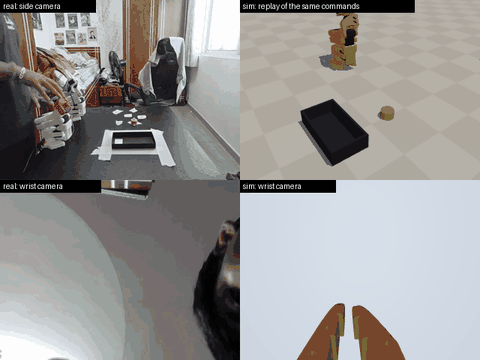
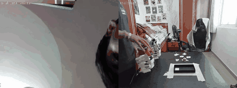
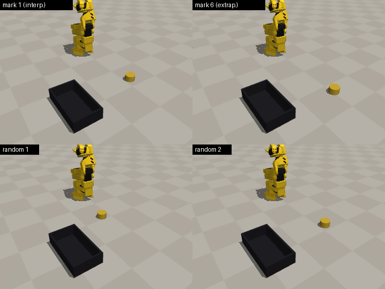
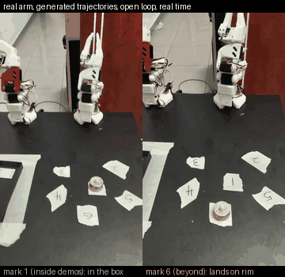

# Real SO-101 demonstrations → a measured MuJoCo twin → generated data: does it teach a robot to pick where nobody showed it?

I recorded pick-and-place demonstrations on a real SO-101 arm, built a MuJoCo twin of
the setup and **measured it against the real arm**, used it to adapt 12 demonstrations
to hundreds of new object positions, ran some of those generated motions **on the real
arm**, and tested whether the generated data stops an imitation-learning policy from
memorising object positions. That memorisation is the failure behind my MSc thesis
result: a fine-tuned VLA scored 0/216 at positions it had not seen.



*One real demonstration (left: side and wrist cameras) and the twin replaying the same
leader commands through the identified actuator model (right).*

## Summary

| question | answer | evidence |
|---|---|---|
| Does the twin match the real arm? | Yes, after measuring it | identified servos are 16–62 vs 998 stiffness in the stock model; held-out tracking error drops on every joint; recorded commands replayed in the twin succeed 12/16 (vs 9/16 stock) |
| Are generated motions physically valid? | Inside the demonstrated area, yes | **on the real arm: 4/4 at mark 1 (interpolation), 0/4 at mark 6 (extrapolation)** |
| Does generated data improve task success? | **No, not under the planned budget** (prediction P2 failed) | 36% vs 35% inside, 34% vs 31% beyond; p = 1 and 0.5 |
| Does it change what the policy learns? | **Yes** | the object is lifted in **77% vs 60%** of unseen-position trials (p = 6e-6, exploratory) |
| Is the gain from the adapted motion, or just from seeing the object in more places? | The adapted motion | the naive-shift control (object moved, motion unchanged) collapses to 2–4% and reaches for empty air in 186 of 294 trials |

Every prediction was written down **before** any data was recorded:
[PREDICTIONS.md](PREDICTIONS.md) (commit `0613d79` precedes all data and results).
[Section 6](#6-predictions-vs-outcome) scores each one, including those that were wrong.

---

## 1. Setup

* **Robot:** SO-101 leader and follower (Feetech STS3215 servos), LeRobot 0.6.1, Windows 11, RTX 5070 Ti laptop.
* **Task:** pick an LED tealight (a 38 × 23 mm cylinder) and drop it in a box.
* **Table:** six taped marks. Demonstrations were recorded at marks **2, 3, 4, 5** only. Mark **1** is inside them
  (interpolation) and mark **6** is beyond them, near the arm's reach (extrapolation).
* **Data:** 20 recorded episodes at 30 Hz: leader commands, follower joints, wrist camera and side camera.
  16 contain a grasp; 12 of those the twin reproduces. Those 12 are the source demonstrations.



## 2. Measuring the twin before trusting it

| what | how | result |
|---|---|---|
| object positions | forward kinematics at the instant the real jaws stall on the tealight, per demonstration | each mark recovered to within 0.5–3.5 cm across demos (hand placement) |
| independent check | top-down photo of the table, similarity-fitted to those measurements | about 1 cm residual on 5 marks |
| joint limits | calibrated range of the real follower | the real arm rests *outside* the stock limits (wrist_flex −102° vs ±95°); limits widened |
| actuators | 200 Hz excitation of each joint (large steps, 1–2° steps, sines); least squares on stiffness, damping, friction, armature | see [results](results/RESULTS.md#digital-twin): stiffness 16–62 vs 998; excitation error 1.8–3.7° → 0.3–0.5°; held-out teleoperation error lower on every joint |
| end to end | replay each demonstration's leader commands in the twin | 9/16 succeed with stock actuators → **12/16 with identified actuators** |

The real servos run LeRobot's soft position gain and lag the operator by up to 40° on fast
moves. The stock model tracks commands almost perfectly, so replaying them whipped the
object out of the jaws.

## 3. Method: object-centric demonstration generation

A simplified [MimicGen](https://mimicgen.github.io) for a 5-DoF arm and *real* recordings
([`real2sim/generate.py`](real2sim/generate.py)):

1. Split the demonstration at the grasp and the release, using the gripper command. Real demonstrations start and end
   with the gripper shut, so the grasp is the first close *after* an opening.
2. Compute the grasp-centre path and approach direction by forward kinematics.
3. Shift the path by the object's displacement. The shift is **completed while the gripper is still high** (before the
   final descent), held through the grasp, and removed before the release (the box does not move).
4. Solve inverse kinematics along the new path. The SO-101 cannot point straight down everywhere, so position is
   exact and the approach direction is a soft goal. Gripper timing is kept.
5. Run the result in physics and keep it only if the object ends in the box.

Finishing the shift *before* the descent matters: 71% of generated trajectories succeed, against 38% when the shift is
ramped during the descent.



*Trajectories generated from one real demonstration for mark 1, mark 6 and two random positions.*

## 4. Generated motions on the real arm

Generated trajectories, open loop (no camera, no policy), with the real tealight on marks never demonstrated:
**mark 1: 4/4 in the box. Mark 6: 0/4**, lifted or pushed but never delivered. Unedited clips are in
[results/media/raw](results/media/raw).



## 5. Policies

ACT policies trained on the twin's rendered cameras (top and wrist) and joint state, 8000 steps, batch 16, 3 seeds;
checkpoint chosen on 12 validation positions; tested on the 4 demonstrated marks and a 7 × 7 grid (2 trials per
position) with identical initial conditions for every policy. Full tables: [results/RESULTS.md](results/RESULTS.md).

| training data | seen marks | inside the demos | beyond the demos | object lifted (unseen positions) |
|---|---|---|---|---|
| the 12 real demonstrations | 62% | 35% | 31% | 60% |
| + 200 generated | 33% | 36% | 34% | **77%** |
| + 200 naive-shift (control) | 4% | 4% | 2% | 8% |


**Reading the results**

* Generated data does **not** raise task success under this budget (Fisher p = 1 inside, 0.5 beyond), and it costs
  success at the demonstrated marks (62% → 33%).
* It **does** change behaviour: the object is lifted far more often at unseen positions (77% vs 60%, p = 6e-6;
  exploratory). Failures move from *pushed* (113 → 66) to *lifted but not delivered* (80 → 124). The policy finds and
  grasps the object better and loses it in transport.
* The three generated-data seeds disagree strongly (beyond the demos: 17%, 27%, 60%); the real-only seeds do not
  (27%, 27%, 38%).
* The naive-shift control reproduces the thesis failure on purpose: 186 of 294 unseen-position trials never touch the
  object. The adapted motion, not the extra object positions, is what makes generated data useful.
* Doubling training steps for the real-only policy does not help (24% inside, 38% beyond, 1 seed).
  <!-- GEN200LONG -->

## 6. Predictions vs outcome

| | prediction (abridged) | outcome | verdict |
|---|---|---|---|
| T1 | model tip within 10 mm of the taped marks after alignment | touch test not completed (operator scoring problem); replaced by grasp-based positions checked against a photo (~1 cm) | not tested as planned |
| T2 | the 5° wrist lag is a static dead band | static error after small steps is ≤ 0.4° on the wrist; the dead-zone register is one encoder tick; the lag is dynamic (soft position loop + 10°/frame command clamp) | **wrong** |
| T3 | identified actuators reduce held-out tracking error on every arm joint | every joint improves | right |
| R1 | ≥ 4/6 real successes at interpolation marks, extrapolation no better | 4/4 at mark 1 (the layout had one interpolation mark); 0/4 at mark 6 | right |
| P1 | real-only: ≥ 50% at seen marks, ≤ 20% beyond | 62% seen, but 31% beyond | **wrong**: real-only does not purely memorise here |
| P2 | generated > real, significant beyond the demos | 34% vs 31%, p = 0.5 | **wrong** |
| P3 | naive-shift does not beat real | 2–4% vs 31–35% | right |
| P4 | generated loses ≤ 10 points at seen marks | 62% → 33% | **wrong** |
| P5 | inside ≥ beyond for every condition | 35/31, 36/34, 4/2 | right |
| F1 | real-only failures mostly no contact | mostly *pushed* (113 of 199); no contact is the naive-shift signature (186) | **wrong** |
| A1 | shifting before the descent beats shifting during it | 71% vs 38% | right |
| A2, A3 | amount of generated data; physics filter | not run (time) | not tested |

## 7. Why generated data did not raise success, and what I would change

1. **Under-training.** 8000 steps are about 24 passes over the real-only data but 1.3 over the generated set. Validation
   success was still rising at the last checkpoint for most runs, and seed variance is large.
   *Next:* train to convergence with the same number of passes per condition.
2. **The carrying phase of the generator.** The shift is removed during transport, so every generated demonstration
   carries the object along a different path. That matches the failure shift towards "lifted, not delivered".
   *Next:* anchor the transport segment to the box so it is identical across generated demonstrations.
3. **The real demonstrations are diluted** (12 of 212 episodes), and success at the demonstrated marks halves.
   *Next:* a fixed share of real demonstrations in every batch.
4. **ACT executes 100-step chunks open loop** (3.3 s), so grasp errors are not corrected before the drop into an
   8 cm box. *Next:* temporal ensembling or shorter chunks.
5. **Beyond the demonstrations is near the reach limit** (mark 6 is 37 cm out, the gripper must tilt about 33°). The
   real arm also failed there, so part of the extrapolation gap is reachability.

## 8. What went wrong along the way

* **The twin looked right and was still wrong.** The kinematics matched the real arm to about 1 cm on the first try,
  but replays failed until the actuators were identified.
* **Data collection bugs are data bugs.** LeRobot's recorder listens to keys system-wide and maps `n`/`r`/`q` to
  next/re-record/quit; typing a chat message cut or restarted demonstrations. The recorder here listens to the arrow
  keys only, and demonstrations are trimmed to exactly one pick.
* **Assumptions from synthetic data broke on real data.** The grasp detector assumed the gripper starts open.
* **Rendering, not learning, was the bottleneck.** 400k-triangle CAD meshes with shadows on the integrated GPU, and PNG
  frames written before encoding: collision geometry, no shadows and streaming encoding made dataset writing about
  100× faster. Training and testing use the same rendering.
* **A scoring typo on the real arm** was corrected with an audit note in the results file; a second real-arm session
  was lost when its terminal closed before saving. Only its two video-verified trials are counted, and the script now
  saves after every trial.

## 9. Limitations

* Policies are trained and evaluated **in simulation** on rendered images: the real data supplies motions, not pixels.
  Running a policy on the real arm needs a vision sim-to-real step (the recorded wrist and side videos are there for
  co-training). The generated *motions* were tested on the real arm.
* One operator, one object, one box position, 12 source demonstrations.
* The tealight is modelled as a plain cylinder (no flame) with estimated mass and friction.
* The physics filter and the policy evaluation use the same simulator, so generated data is validated by the judge.
  The real-arm runs are the check on that.
* Compute-matched training (8000 steps); the 2× runs are post-hoc and single-seed.
* Mark 6 and the box positions come from the photo fit (about 1 cm).

## 10. Reproduce

```bash
python -m venv .venv && .venv\Scripts\pip install -e ".[dev]"
python scripts/prepare_data.py episodes                    # positions + task frames; replay check
python scripts/sysid.py fit --log data/sysid/excite_<time>.npz --validate data/so101_real
python scripts/prepare_data.py generate --total 0 --include-replays --out data/datasets/real
python scripts/prepare_data.py generate --total 200 --include-replays --out data/datasets/gen200
python scripts/prepare_data.py generate --total 200 --include-replays --mode naive --out data/datasets/naive200
python scripts/prepare_data.py generate --total 200 --keep-failures --no-render --out data/datasets/timing_before
python scripts/prepare_data.py generate --total 200 --keep-failures --no-render --shift-timing during --out data/datasets/timing_during
python scripts/experiments.py --parallel 3                 # trains and evaluates every run
python scripts/analyse.py                                  # every number and figure, from results/
python -m pytest tests
```

On the robot: `scripts/record_real.py` (recording), `scripts/sysid.py excite` (servo excitation),
`scripts/execute_real.py` (generated trajectories on the real arm). The recordings themselves are not in the
repository (size); everything derived from them is, in `results/`.

```
real2sim/   sim.py (twin + table layout)   data.py (datasets, demonstrations, replay)   kinematics.py
            generate.py (the method)       hardware.py (real arm)                       stats.py
scripts/    record_real  sysid  prepare_data  experiments  evaluate  execute_real  analyse
config/     table layout, arm calibration       sim/  MuJoCo scene, SO-101 model, identified actuators
results/    every number, figure and video in this README
```

## 11. Related work

MimicGen (Mandlekar et al., CoRL 2023) generates large datasets from a few demonstrations in simulation; this is a
simplified version for a 5-DoF arm driven by real recordings. DemoGen (2025) adapts demonstrations on real point
clouds; Real2Render2Real (CoRL 2025) renders robot data from a phone scan and a human video. so101-nexus provides SO-101
MuJoCo environments without real-to-sim replay or generation.
