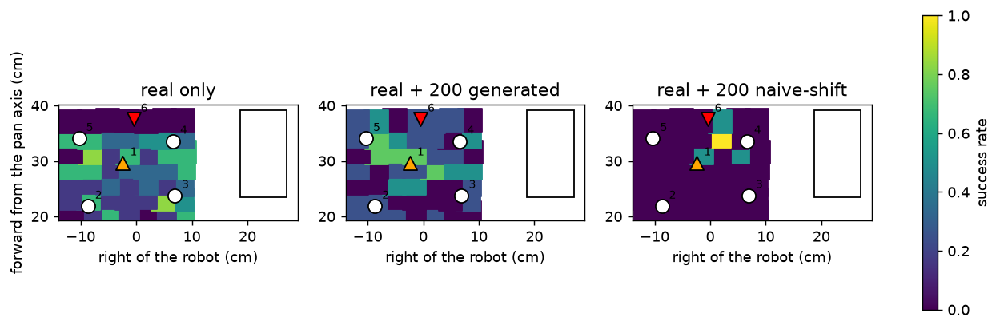

# Results

_Generated by `scripts/analyse.py` from the files in results/._

## Digital twin

Actuator identification (200 Hz servo excitation; validation on held-out teleoperation):

| joint | excitation RMSE default → fitted (deg) | held-out teleoperation RMSE default → fitted (deg) | fitted kp (Menagerie: 998) | steady-state error after 1-2 deg steps (deg) |
|---|---|---|---|---|
| shoulder_pan | 1.85 → 0.32 | 1.29 → 0.45 | 62 | 0.36 |
| shoulder_lift | 1.8 → 0.45 | 7.11 → 5.03 | 21 | 1.01 |
| elbow_flex | 2.42 → 0.53 | 4.2 → 2.53 | 16 | 1.66 |
| wrist_flex | 1.91 → 0.46 | 5.68 → 1.73 | 51 | 0.54 |
| wrist_roll | 3.15 → 0.43 | 2.4 → 1.63 | 49 | 0.40 |
| gripper | 3.65 → 0.36 | 7.21 → 5.12 | 50 | 0.34 |

Recorded leader commands replayed in the twin (object at the position measured from the grasp): default actuators: 9/16 succeed; identified actuators: 12/16 succeed

Object position recovered from each real grasp, spread across demonstrations per mark:

- mark 2: 4 demonstrations, 2.0 cm forward x 0.8 cm sideways
- mark 3: 4 demonstrations, 3.6 cm forward x 1.6 cm sideways
- mark 4: 4 demonstrations, 0.5 cm forward x 1.0 cm sideways
- mark 5: 4 demonstrations, 1.2 cm forward x 0.8 cm sideways

## Generated trajectories executed open loop on the real arm

| mark | role | in the box |
|---|---|---|
| 1 | interp | 4/4 = 100% [51, 100] |
| 6 | extrap | 0/4 = 0% [0, 49] |

## Demonstration generation (physics success of generated trajectories)

| variant | success |
|---|---|
| displacement finished before the final descent (method) | 142/200 = 71% [64, 77] |
| displacement ramped during the descent (ablation) | 75/200 = 38% [31, 44] |
| naive shift: source commands unchanged (negative control) | 6/200 = 3% [1, 6] |
| method, as rendered for training | 200/277 = 72% [67, 77] |

## Policies (ACT, closed loop in simulation)

Success with 95% Wilson intervals, pooled over training seeds; checkpoints chosen on validation positions only.

| condition | seeds | seen marks | interpolation | extrapolation |
|---|---|---|---|---|
| real only | 3 | 15/24 = 62% [43, 79] | 40/114 = 35% [27, 44] | 55/180 = 31% [24, 38] |
| real + 200 generated | 2 | 3/16 = 19% [7, 43] | 23/76 = 30% [21, 41] | 26/120 = 22% [15, 30] |
| real + 200 naive-shift | 1 | 1/8 = 12% [2, 47] | 2/38 = 5% [1, 17] | 3/60 = 5% [2, 14] |

**Per seed** (success %):

- real only: seen 62, 62, 62; interp 34, 37, 34; extrap 27, 27, 38
- real + 200 generated: seen 0, 38; interp 26, 34; extrap 17, 27
- real + 200 naive-shift: seen 12; interp 5; extrap 5

**Tests** (pooled over seeds): Fisher's exact on the success counts, and exact McNemar on trials paired by seed, position and trial.

| A | B | set | Fisher p | McNemar: only B / only A succeeds, p |
|---|---|---|---|---|
| real only | real + 200 generated | interp | 0.532 | 11 / 15, p = 0.557 |
| real only | real + 200 generated | extrap | 0.111 | 16 / 22, p = 0.418 |
| real only | real + 200 naive-shift | interp | 0.000254 | 1 / 12, p = 0.00342 |
| real only | real + 200 naive-shift | extrap | 1.91e-05 | 1 / 14, p = 0.000977 |
| real + 200 naive-shift | real + 200 generated | interp | 0.00174 | 9 / 1, p = 0.0215 |
| real + 200 naive-shift | real + 200 generated | extrap | 0.00445 | 9 / 2, p = 0.0654 |

**How the trials ended** (interpolation + extrapolation, pooled). "Lifted" = success + lifted but not delivered.

| condition | success | no contact | pushed | lifted, not delivered | lifted |
|---|---|---|---|---|---|
| real only | 95 | 6 | 113 | 80 | 175/294 = 60% [54, 65] |
| real + 200 generated | 49 | 1 | 57 | 89 | 138/196 = 70% [64, 76] |
| real + 200 naive-shift | 5 | 57 | 32 | 4 | 9/98 = 9% [5, 17] |

White circles: demonstrated marks; orange/red triangles: the marks used for the real-arm test; rectangle: the box.
